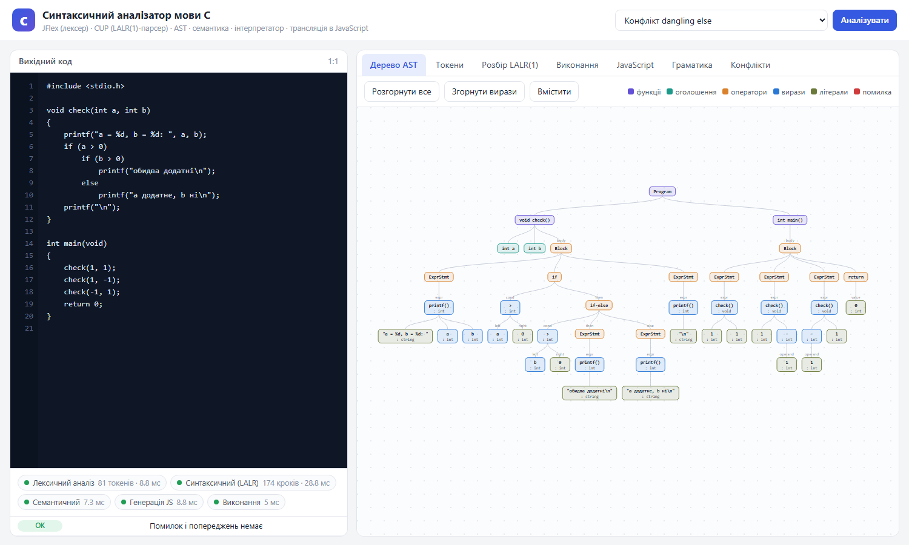
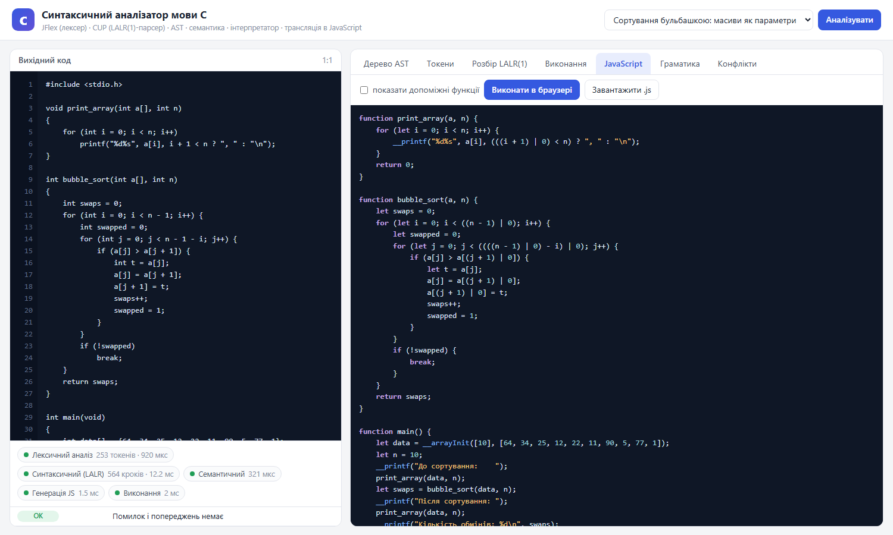
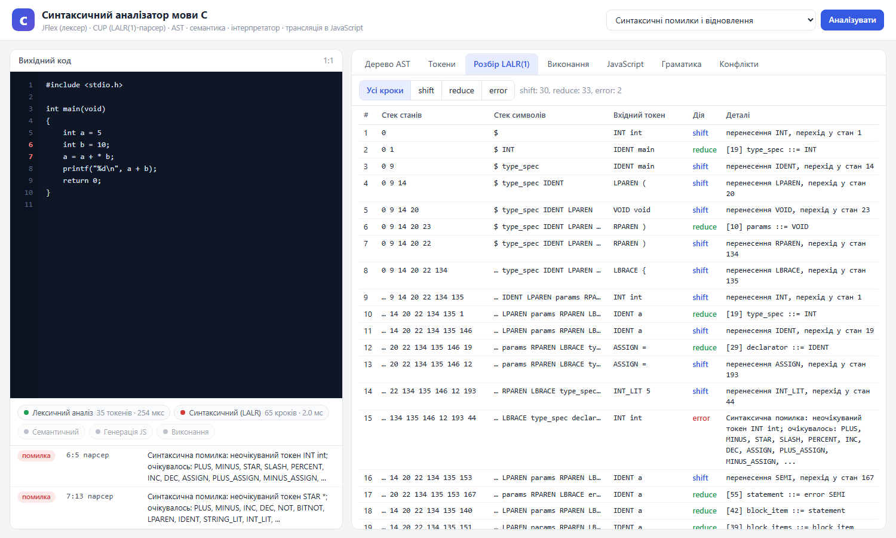
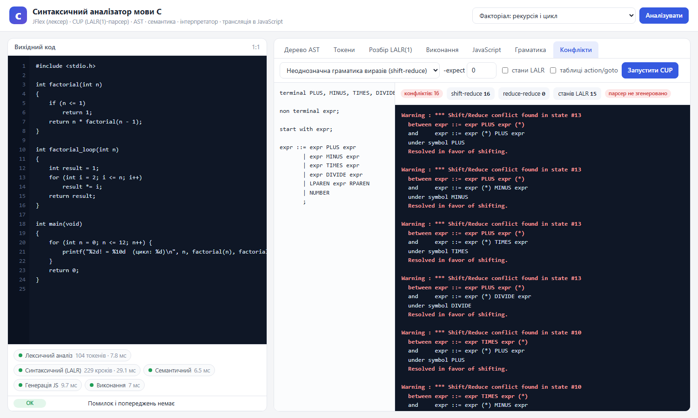

# Лабораторна робота 3. Синтаксичний аналізатор мови C (JFlex + CUP)

Транслятор підмножини мови C, написаний на Java з використанням **JFlex** (аналог Lex) і **CUP** (аналог YACC, генерує LALR(1)-парсер). Програма будує AST, перевіряє семантику, виконує програму інтерпретатором і транслює її в JavaScript. Для зручності є вебінтерфейс: дерево AST на d3.js, таблиця токенів, покрокова траса LALR-розбору, запуск згенерованого коду в браузері і окрема вкладка для експериментів з конфліктами граматик.



## Що реалізовано

| Пункт завдання | Реалізація |
|---|---|
| Синтаксичний аналізатор на Lex/YACC | JFlex-лексер [`c.flex`](src/main/jflex/c.flex) + CUP-граматика [`c.cup`](src/main/cup/c.cup), LALR(1), 112 продукцій, 208 станів |
| Граматика мови C | функції, прототипи, глобальні й локальні змінні, масиви (у т.ч. багатовимірні), `if/else`, `while`, `do-while`, `for`, `break`, `continue`, `return`, усі арифметичні, логічні, бітові оператори, присвоєння `+= -= ...`, `++/--`, `?:`, приведення типів |
| Семантика / обчислення | семантичний аналізатор (таблиця символів, типи, перевірки) + інтерпретатор AST |
| Генерація коду на цільовій мові | трансляція C → JavaScript, код запускається в Node.js і в браузері |
| Візуалізація AST | інтерактивне дерево на d3.js у браузері: згортання вузлів, масштабування, типи виразів, перехід до рядка коду |
| Теорія LALR, конфлікти | покрокова траса shift/reduce, вкладка «Конфлікти», де CUP генерує парсер для навчальних граматик і показує shift-reduce та reduce-reduce конфлікти |

## Запуск

Потрібні JDK 21 і Maven.

```bash
mvn package
java -jar target/c-parser.jar
```

Відкриється браузер з адресою `http://localhost:8080`. Інший порт: `--port 9000`, без автоматичного відкриття браузера: `--no-browser`. На Windows можна запустити `run.bat`.

Режим командного рядка:

```bash
java -jar target/c-parser.jar program.c              # AST + виконання
java -jar target/c-parser.jar program.c --tokens     # токени
java -jar target/c-parser.jar program.c --trace      # траса LALR-розбору
java -jar target/c-parser.jar program.c --js         # згенерований JavaScript
java -jar target/c-parser.jar program.c -o out.js    # зберегти JavaScript у файл
node out.js
```

Тести: `mvn test`.

## Архітектура

```
вихідний код C
      │
      ▼
 ┌──────────┐  токени   ┌─────────────┐   AST   ┌────────────┐  AST з типами  ┌──────────────┐
 │  Lexer   │ ────────► │   Parser    │ ──────► │  Analyzer  │ ─────────────► │ Interpreter  │ → вивід програми
 │ (JFlex)  │           │ (CUP LALR1) │         │ (семантика)│                ├──────────────┤
 └──────────┘           └─────────────┘         └────────────┘                │ JsGenerator  │ → JavaScript
                              │                                                └──────────────┘
                              └─ траса shift/reduce (TracingParser)
```

| Пакет | Призначення |
|---|---|
| `src/main/jflex/c.flex` | специфікація лексера |
| `src/main/cup/c.cup` | граматика, пріоритети операторів, семантичні дії побудови AST |
| `cparser.ast` | класи вузлів AST і типів |
| `cparser.parse.TracingParser` | наслідник згенерованого парсера: записує кроки розбору, формує повідомлення про синтаксичні помилки |
| `cparser.semantic.Analyzer` | таблиця символів з областями видимості, виведення типів, семантичні перевірки |
| `cparser.runtime` | інтерпретатор AST і реалізація `printf` |
| `cparser.codegen.JsGenerator` | генерація JavaScript |
| `cparser.web` | HTTP-сервер (вбудований `com.sun.net.httpserver`) і JSON |
| `cparser.tools.ConflictLab` | запуск генератора CUP для довільної граматики |
| `src/main/resources/web` | вебінтерфейс (HTML, CSS, JavaScript, d3.js) |
| `src/main/resources/examples` | приклади програм |
| `src/main/resources/conflicts` | навчальні граматики з конфліктами |

## Лексичний аналіз

JFlex за регулярними виразами з `c.flex` будує детермінований скінченний автомат. Лексер:

- розпізнає ключові слова, ідентифікатори, цілі (десяткові, `0x..`, вісімкові), дійсні числа з експонентою, символьні літерали з escape-послідовностями, рядки;
- пропускає пробіли, коментарі `//` і `/* */`, рядки препроцесора `#include`;
- для кожного токена зберігає рядок і стовпець;
- при невідомому символі, незакритому рядку чи коментарі повідомляє лексичну помилку з позицією.

Для конфлікту між правилами JFlex використовує два принципи: найдовше збігання (`<=` замість `<`, `+=` замість `+`) і пріоритет правила, що стоїть вище (ключове слово `int` проти правила для ідентифікатора).

## Граматика та розбір

Граматика записана в нотації CUP (BNF з семантичними діями). Кожна продукція має дію `{: RESULT = ... :}`, яка під час згортки (reduce) створює вузол AST із значень символів правої частини. Це синтезовані атрибути, аналог `$$ = ...` в yacc.

```
expr ::= expr:a PLUS:o expr:b   {: RESULT = new Binary("+", a, b, oleft, oright); :}
       | MINUS:o expr:a         {: RESULT = new Unary("-", a, oleft, oright); :} %prec UMINUS
       ...
```

Граматика виразів навмисно неоднозначна (як у класичному прикладі yacc), а порядок обчислення задається таблицею пріоритетів. Це коротше за багаторівневу граматику `expr/term/factor` і відповідає стандарту C:

| Рівень (від найнижчого) | Асоціативність | Оператори |
|---|---|---|
| 1 | right | `= += -= *= /= %= &= \|= ^= <<= >>=` |
| 2 | right | `?:` |
| 3 | left | `\|\|` |
| 4 | left | `&&` |
| 5 | left | `\|` |
| 6 | left | `^` |
| 7 | left | `&` |
| 8 | left | `== !=` |
| 9 | left | `< > <= >=` |
| 10 | left | `<< >>` |
| 11 | left | `+ -` |
| 12 | left | `* / %` |
| 13 | right | унарні `- + ! ~ ++ --`, приведення типу |
| 14 | left | індексація `[ ]` |
| 15, 16 | nonassoc | `IFX`, `ELSE` (для dangling else) |

CUP генерує граматику без жодного нерозв'язаного конфлікту. Усі неоднозначності знято через `precedence` і `%prec`.

### Обробка синтаксичних помилок

У граматиці є продукція `statement ::= error SEMI`. Коли парсер натрапляє на помилку, він знімає стани зі стеку, доки не знайде стан з переходом за токеном `error`, переносить `error` і пропускає вхід до `;`. Завдяки цьому одна помилка не зупиняє розбір, і програма повідомляє про кілька помилок одразу (приклад `syntax_errors.c`). Повідомлення містить позицію і список очікуваних токенів, отриманий з таблиці ACTION для поточного стану.

## AST і семантичний аналіз

Вузли AST поділено на оголошення (`FunctionDef`, `VarDecl`, `Declarator`, `Param`), оператори (`Block`, `If`, `While`, `For`, `Return` ...) і вирази (`Binary`, `Unary`, `Assign`, `Call`, `Index`, `Cast`, літерали). Кожен вузол знає рядок і стовпець у вихідному коді.

`Analyzer` обходить дерево з таблицею символів у вигляді стеку областей видимості (глобальна, функція, блок, цикл `for`) і:

- обчислює тип кожного виразу (`int`, `char`, `float`, `double`, масиви) за правилами звичайних арифметичних перетворень C;
- перевіряє оголошення до використання, повторні оголошення, кількість і типи аргументів функцій;
- перевіряє, що ліворуч від присвоєння стоїть змінна чи елемент масиву;
- забороняє `%` і бітові операції для дійсних чисел, `break`/`continue` поза циклом, повернення значення з `void`-функції;
- перевіряє розміри й ініціалізатори масивів;
- звіряє формат `printf` з типами аргументів (попередження на зразок `%d` для `double`).

## Обчислення (інтерпретатор)

Інтерпретатор обходить AST після семантичного аналізу. Цілі числа мають 32-бітну семантику з переповненням, `char` обрізається до 8 біт, `float` округлюється до одинарної точності, ділення цілих відкидає дробову частину. Реалізовано стандартні функції `printf` (прапорці, ширина, точність, `%d %i %u %o %x %X %f %e %g %c %s`), `puts`, `putchar`, `sqrt`, `pow`, `fabs`, `abs`, `floor`, `ceil`, `sin`, `cos`, `exp`, `log`.

Помилки часу виконання (ділення на нуль, вихід за межі масиву, переповнення стеку рекурсії) повідомляються з номером рядка. Для захисту від нескінченних циклів є ліміт кроків і тайм-аут.

## Генерація JavaScript

`JsGenerator` перетворює AST з типами в JavaScript. Оскільки в JavaScript є лише 64-бітні дійсні числа, для збереження семантики C використовуються:

| C | JavaScript |
|---|---|
| `a + b`, `a - b` для `int` | `(a + b) \| 0` |
| `a * b` для `int` | `Math.imul(a, b)` |
| `a / b`, `a % b` для `int` | `__idiv(a, b)`, `__imod(a, b)` (перевірка ділення на нуль) |
| `float` | `Math.fround(...)` |
| `(int) x` | `__toInt(x)` |
| `a < b` у виразі | `(a < b ? 1 : 0)`, в умові просто `a < b` |
| `int m[3][4];` | `let m = __array([3, 4]);` |
| `printf(...)` | `__printf(...)` з тією ж логікою форматування |



## Вебінтерфейс

- **Дерево AST**: d3.js, колір вузла відповідає категорії, біля ребер підписано роль дочірнього вузла (`cond`, `then`, `left` ...), під виразом показано його тип. Клік згортає піддерево, подвійний клік виділяє відповідний рядок у редакторі, коліщатко миші масштабує.
- **Токени**: результат роботи лексера.
- **Розбір LALR(1)**: кожен крок парсера — стек станів, стек символів, вхідний токен і дія (`shift` з новим станом, `reduce` з номером і текстом продукції, `accept`, `error`).
- **Виконання**: вивід інтерпретатора, код повернення `main`, кількість кроків.
- **JavaScript**: згенерований код, його запуск у браузері і порівняння результату з інтерпретатором.
- **Граматика**: таблиця пріоритетів, усі продукції з номерами (ті самі номери, що в трасі), вихідні `c.cup` і `c.flex`.
- **Конфлікти**: редактор граматики CUP і запуск генератора CUP з параметром `-expect`, виводом станів LALR і таблиць action/goto.



## Перевірка коректності

- `mvn test` запускає 24 тести: пріоритети й асоціативність операторів, dangling else, керування потоком, масиви, `printf`, відновлення після синтаксичних помилок, семантичні та runtime-помилки, звірку номерів продукцій з таблицями CUP, звіти про конфлікти.
- Для кожного коректного прикладу тест виконує згенерований JavaScript у Node.js і порівнює вивід з інтерпретатором.
- Вивід усіх прикладів додатково звірено з програмами, скомпільованими `gcc` в Ubuntu: результати збігаються побайтово.

---

## Теорія

### Lex і YACC

**Lex** (тут JFlex) отримує список пар «регулярний вираз → дія» і будує з них скінченний автомат (регулярні вирази → НСА → ДСА → мінімізація). Згенерований лексер читає символи, доки автомат може продовжувати, і виконує дію для найдовшого розпізнаного префікса.

**YACC** (тут CUP) отримує контекстно-вільну граматику в BNF з діями і будує таблиці LALR(1)-аналізатора. Сам парсер — це універсальний драйвер (магазинний автомат), який працює за таблицями:

- `ACTION[стан, термінал]` — одна з дій: `shift s`, `reduce A → β`, `accept`, `error`;
- `GOTO[стан, нетермінал]` — стан після згортки.

Алгоритм розбору:

1. На стеку стани, на вході поточний токен `a`, верхній стан `s`.
2. Якщо `ACTION[s, a] = shift t` — покласти `t` на стек, прочитати наступний токен.
3. Якщо `ACTION[s, a] = reduce A → β` — зняти зі стеку `|β|` станів, виконати семантичну дію продукції, покласти `GOTO[s', A]`, де `s'` — новий верхній стан.
4. `accept` — успіх, `error` — синтаксична помилка (і відновлення через `error`).

Лексер викликається парсером на вимогу: щоразу, коли потрібен наступний токен.

### Приклад розбору `return 2 + 3 * 4;`

Фрагмент траси з вкладки «Розбір LALR(1)»:

```
10  shift   INT_LIT 2   перенесення INT_LIT, перехід у стан 44
11  reduce  PLUS +      [104] expr ::= INT_LIT
12  shift   PLUS +      перенесення PLUS, перехід у стан 57
13  shift   INT_LIT 3   перенесення INT_LIT, перехід у стан 44
14  reduce  STAR *      [104] expr ::= INT_LIT
15  shift   STAR *      перенесення STAR, перехід у стан 64
16  shift   INT_LIT 4   перенесення INT_LIT, перехід у стан 44
17  reduce  SEMI ;      [104] expr ::= INT_LIT
18  reduce  SEMI ;      [63] expr ::= expr STAR expr
19  reduce  SEMI ;      [61] expr ::= expr PLUS expr
```

На кроці 15 на стеку `expr PLUS expr`, а вхідний токен `*`. Можна згорнути `expr PLUS expr` або перенести `*`. Це shift-reduce конфлікт, розв'язаний на етапі генерації таблиць: `STAR` має вищий пріоритет за продукцію з `PLUS`, тому в таблиці стоїть shift. Згортки 18–19 будують дерево `2 + (3 * 4)`.

### LR(0)-пункти, LR(1) і LALR(1)

- **LR(0)-пункт** — продукція з позначкою позиції: `expr → expr • PLUS expr`. Стан автомата — множина пунктів, отримана операціями `closure` і `goto`.
- **SLR(1)** вирішує, коли згортати, за множиною FOLLOW нетермінала. Це часто дає хибні конфлікти.
- **LR(1)-пункт** додає до пункту символ передогляду: `[A → α •, a]`. Канонічний LR(1) найпотужніший, але кількість станів дуже велика.
- **LALR(1)** будує LR(1)-стани і зливає ті, що мають однакове ядро (однакові LR(0)-частини), об'єднуючи символи передогляду. Станів стільки ж, скільки в LR(0)/SLR (для нашої граматики C — 208), а потужність майже як у LR(1). Саме цей метод використовують yacc, bison і CUP.

Злиття станів не може створити новий shift-reduce конфлікт, але може створити **reduce-reduce**. Приклад — граматика `lalr_merge.cup` у вкладці «Конфлікти»:

```
s ::= A x C | A y D | B y C | B x D ;
x ::= E ;
y ::= E ;
```

У LR(1) після `A E` маємо `[x → E•, C]` і `[y → E•, D]`, а після `B E` маємо `[y → E•, C]` і `[x → E•, D]`. Конфліктів немає. LALR зливає ці стани (ядро однакове), і в одному стані з'являються `x → E•` і `y → E•` з однаковим передоглядом `{C, D}`. CUP повідомляє: `Reduce/Reduce conflict ... under symbols: {C, D}`.

### Конфлікти

**Shift-reduce**: в одному стані є завершений пункт `A → α•` з передоглядом `a` і пункт `B → β • a γ`. Парсер не знає, згортати чи переносити. Типові причини — неоднозначні вирази та dangling else.

**Reduce-reduce**: в одному стані два завершені пункти `A → α•` і `B → α•` з тим самим передоглядом. Зазвичай це помилка в граматиці (приклад `reduce_reduce.cup`: ідентифікатор може бути і змінною, і назвою функції).



### Як yacc і CUP розв'язують конфлікти

1. Кожен термінал з оголошень `precedence` (у yacc `%left`, `%right`, `%nonassoc`) отримує рівень пріоритету: що нижче рядок оголошення, то вищий пріоритет.
2. Продукція отримує пріоритет свого останнього термінала або термінала, вказаного в `%prec`.
3. Для shift-reduce конфлікту порівнюються пріоритет продукції і пріоритет вхідного токена:
   - вищий у продукції → reduce;
   - вищий у токена → shift;
   - рівні → асоціативність: `left` → reduce, `right` → shift, `nonassoc` → помилка.
4. Якщо пріоритетів немає: shift-reduce розв'язується на користь **shift**, reduce-reduce — на користь продукції, що записана в граматиці **раніше**. Обидва випадки супроводжуються попередженням. Yacc лише попереджає, а CUP зупиняє генерацію, якщо конфліктів більше, ніж дозволено параметром `-expect N`.

Приклади з цієї граматики:

- `a - b - c`: `MINUS` лівоасоціативний → reduce → `(a - b) - c`.
- `a = b = c`: `ASSIGN` правоасоціативний → shift → `a = (b = c)`.
- `-a * b`: продукція `MINUS expr` має `%prec UMINUS` (рівень 13), а `*` нижчий → reduce → `(-a) * b`. Без `%prec` продукція мала б пріоритет бінарного мінуса, і вийшло б `-(a * b)`.
- `-a[i]`: `LBRACKET` має вищий пріоритет → shift → `-(a[i])`.

### Dangling else

```c
if (a) if (b) x(); else y();
```

Після `if (a) if (b) x();` з вхідним `else` можна згорнути внутрішній `if` без `else` або перенести `else`. Без пріоритетів CUP повідомляє один shift-reduce конфлікт і розв'язує його на користь shift, тобто `else` належить найближчому `if`, як і вимагає стандарт C (граматика `dangling_else.cup`). У нашій граматиці конфлікт знято явно: продукція `if` без `else` має `%prec IFX`, а `IFX` нижчий за `ELSE`, тому вибирається shift. Результат видно в AST прикладу `dangling_else.c`.

## Обмеження

Не підтримуються вказівники, структури, `switch`, `goto`, рядкові змінні (рядки — лише як аргументи `printf`/`puts`), `typedef`, `long`, `unsigned` і препроцесор (рядки `#...` пропускаються).
